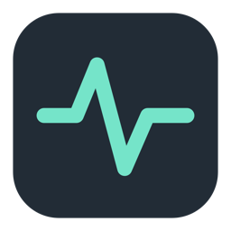
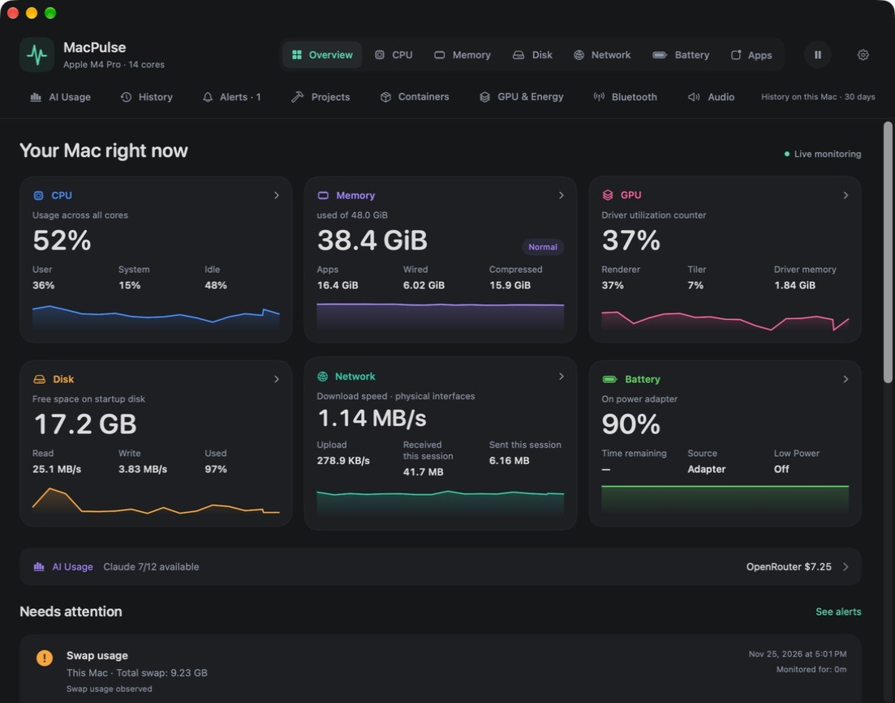
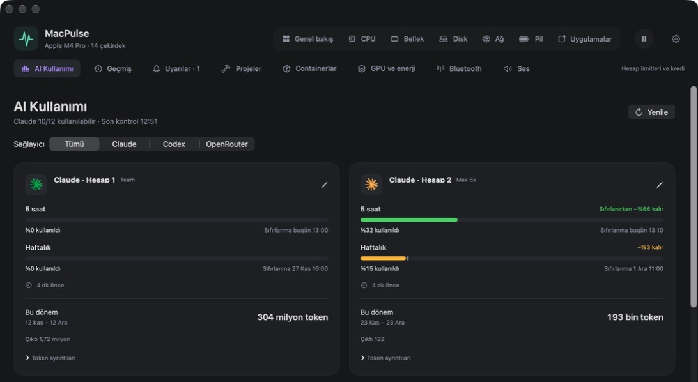
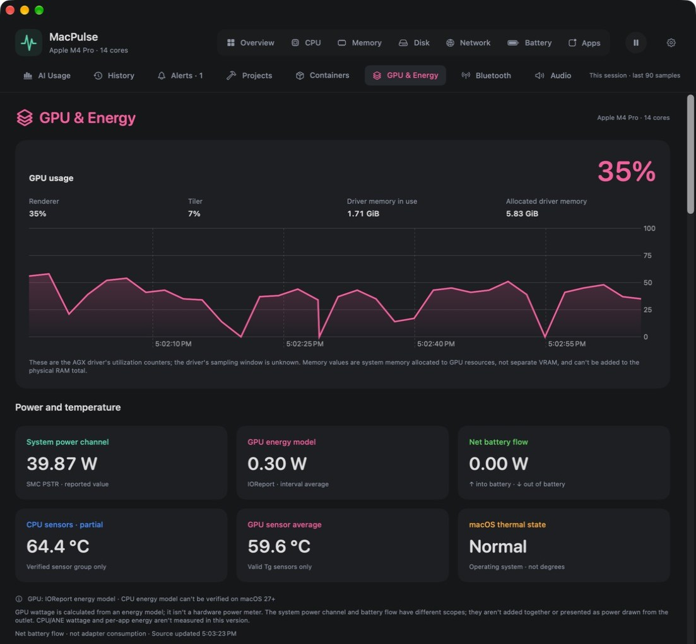
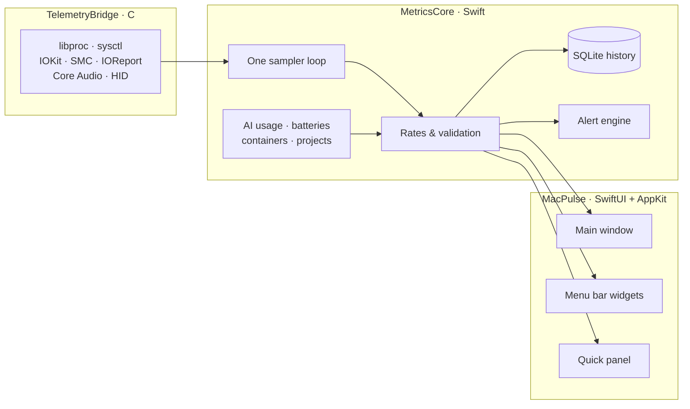

<div align="center">



# MacPulse

**Your Mac's vital signs, your AI coding limits and every battery you own, all in one native menu bar app.**

<p>
  
  
  
  
  
  
</p>

**English** · [Türkçe](README.tr.md)



</div>

---

## Why MacPulse?

If you code with AI agents all day, you keep checking three things: *is my Mac struggling, how much of my Claude / Codex limit is left, and are my AirPods about to die?* Those answers normally live in Activity Monitor, a terminal command, a browser tab and the Bluetooth menu.

MacPulse puts all of them in one place, with one sampler running in the background. You can build your own menu bar out of the numbers you care about.

- **AI limits at a glance.** It reads 5-hour and weekly limits for **multiple Claude Code accounts**, plus Codex and OpenRouter credit, with reset times and a pace forecast that tells you whether you'll hit the wall before the window resets.
- **A real system monitor.** It covers CPU, memory pressure, disk, network, GPU, power, temperatures and fans, grouped by *app* rather than by a wall of process names.
- **Every battery in one list.** Mac, AirPods (left/right/case), Bluetooth accessories, Logitech mice and keyboards, and paired iPhone, iPad, Apple Watch and Apple Pencil, with 7-day history.
- **Developer-aware.** It maps listening ports to the project folders that own them and reads local Docker, OrbStack and Podman containers without touching them.
- **Local, read-only, honest.** No account, no server, no analytics. Unknown values show as `—`, never as a fake `0`.

## Features

### 🤖 AI usage



| | |
|---|---|
| **Claude Code, many accounts** | Your default `~/.claude` login plus any extra config folders (`~/.claude-hesap2`, `~/.claude-hesap3`, …) each get their own card: plan, 5-hour and weekly usage, reset times. |
| **Pace forecast** | A linear projection of where each limit will be when the window ends. "On track", "close to the limit" or "will run out before reset", shown in green, amber and red. |
| **Token totals** | Input, output and both cache counts for the current billing period, computed **locally** from Claude Code transcripts and de-duplicated by message ID. Message content is never stored or sent. |
| **Codex & OpenRouter** | Codex limits from your existing `~/.codex` login and your OpenRouter credit balance from the Keychain. |
| **Gentle on APIs** | It calls the network only when the cached reading is older than 5 minutes or you press Refresh (`⌘R`), with backoff shared across accounts. Credentials are read-only and are never refreshed, written or logged. |

### 🖥️ System monitor

- **CPU.** User, system and idle across all cores, plus per-app CPU where one core is 100%.
- **Memory.** Used vs. available, app / wired / compressed breakdown, swap and the OS memory-pressure level.
- **Disk.** Free space on the startup volume and live read/write throughput from physical drives.
- **Network.** Download and upload from *physical* interfaces only, so VPN, bridge and loopback traffic is never double-counted.
- **GPU & energy.** Apple GPU (AGX) renderer and tiler usage, GPU memory, the GPU energy model in watts, the system power rail, battery net flow, validated temperature sensors and real fan RPM.
- **Apps, not processes.** Helpers and XPC services roll up into their parent app. Search, sort by CPU, memory or name, and drill into PID, parent, RSS and start time.
- **Bluetooth & audio.** Device inventory and connection state, plus Core Audio devices with defaults, channels, sample rate and volume.



### 🔋 Device batteries

- Mac battery with power source, time remaining and Low Power Mode.
- AirPods and other Bluetooth accessories, with **left, right and case** reported separately.
- Logitech devices over **HID++**. The Input Monitoring permission is requested only when you press the button.
- Previously trusted **iPhone, iPad, Apple Watch and Apple Pencil**.
- 6-hour, 24-hour and 7-day history per device, plus rename, favourite, hide, reorder and low-battery alerts.
- Any device can become its own menu bar widget.

### 🧑‍💻 For developers

- **Projects.** Listening TCP ports are matched to the nearest project root (`.git`, SwiftPM, Node, Python, Rust, Go, Ruby, Java, PHP, CMake), with a live process tree and an "idle server" hint.
- **Containers.** Docker Desktop, OrbStack and Podman are read through their local socket using `GET` requests only. That covers status, port mappings, Compose project, CPU, memory and network. MacPulse never starts, stops or kills anything.

### 📈 History & alerts

- 30 days of local history in SQLite, with 1 h / 24 h / 7 d / 30 d views weighted by measured time rather than sample count.
- Alerts are built in:
  - sustained high CPU (system ≥ 85% or a single app ≥ 80% for 2 minutes);
  - heavy disk or network activity;
  - memory growth (≥ 512 MiB in 10 minutes);
  - swap use.
- macOS notifications are **off by default** and are only requested when you turn them on.

### 🧩 Your menu bar, your way

- A widget editor where every metric, every AI account and every device is its own widget. Add, remove, reorder, and choose bar, percent or both, plus used or remaining.
- The **"AI · En yüksek 4 (5 saat)"** mode ("top 4, 5-hour") always shows the four accounts closest to their 5-hour limit.
- A quick panel (`⌘⇧M`) with AI, Mac and battery views. The live preview uses the same renderer as the real menu bar.

## Install & build

MacPulse is built from source with SwiftPM. There are no external packages to download.

**Requirements:** macOS 14 or later, and Xcode or the Command Line Tools with Swift 6.

```sh
git clone https://github.com/ozanbilgili/macpulse.git
cd macpulse

swift test --build-system native                 # run the test suite
SIGNING_MODE=adhoc Scripts/package_app.sh release   # builds ./MacPulse.app
Scripts/launch.sh                                   # opens it
```

- The app is **ad-hoc signed for your own Mac**. There is no notarized download yet.
- Quit a running copy with `⌘Q` before repackaging. The script refuses to replace a running app and only swaps in the new bundle after it passes its checks.
- **Optional:** with Homebrew's `libimobiledevice` installed, the packager also builds the Apple Watch battery helper. Without it, everything else still works.

### Headless probe

`MacPulseProbe` runs the same metrics core from the terminal and prints JSON. It is handy for checking what your Mac exposes.

```sh
swift run --build-system native MacPulseProbe --samples 10
swift run --build-system native MacPulseProbe --verify-hardware --verify-history
```

## Keyboard shortcuts

| Shortcut | Action | Shortcut | Action |
|---|---|---|---|
| `⌘1` … `⌘7` | Overview, CPU, Memory, Disk, Network, Battery, Apps | `⌘⇧U` | AI usage |
| `⌘8` | History | `⌘⇧W` | Menu bar widget editor |
| `⌘9` | Alerts | `⌘⇧M` | Quick panel |
| `⌘0` / `⌘⇧0` | Projects / Containers | `⌘⇧P` | Pause / resume monitoring |
| `⌘⇧G` | GPU & energy | `⌘R` | Refresh AI usage |
| `⌘⇧B` / `⌘⇧S` | Bluetooth / Audio | `⌘,` | Preferences |

## How it works



- **One sampler** runs off the main thread: every 2 seconds when a window is visible (2, 5 or 10 s is configurable) and every 10 seconds in the background. Closing the window doesn't stop it.
- System API access lives in `TelemetryBridge`, the math in `MetricsCore`, and the views in `MacPulse`. A suite of 200+ tests covers `MetricsCore`.
- Process identity is **PID plus start time**, so a recycled PID is never mistaken for the old process.
- After sleep, pause or a long gap, the first sample becomes a new baseline. Traffic during the gap is never reported as a speed spike.

## Privacy

- **Everything stays on your Mac.** There are no accounts, analytics, ads, crash reports or app server.
- The only network calls are the AI usage requests. They go to each provider's own API (usage limits, OpenRouter credit and, for Claude, the account profile) with the credential you already have.
- System monitoring reads metadata, not content. File contents, process arguments and environment variables are never read, and project detection only checks whether marker files *exist*.
- AI usage is the one exception. It reads Claude Code transcripts **locally** to count tokens and keeps only the numbers. Message content is never stored or sent.
- History files are readable only by your user. Process lists, project paths, container data and Bluetooth addresses never go into the history database.
- Device batteries have their own private store (folder `0700`, files `0600`). A Bluetooth device's ID there can include its address.

Full details are in [docs/PRIVACY.md](docs/PRIVACY.md) (Turkish).

## Status & limitations

MacPulse is a personal project that I use every day. Please read these before you try it.

- **The UI is in English and Turkish.** MacPulse follows your macOS language (Turkish when you prefer Turkish, English otherwise), and numbers, percentages and dates follow your region settings. Some docs are still Turkish-only. New translations are welcome: strings live in `Sources/MacPulse/Resources/Localizable.xcstrings`, and `python3 Scripts/localization.py check` validates them.
- **It is tested on one machine** (Apple M4 Pro, macOS 27). Intel Macs and older macOS versions are untested.
- **SMC and IOReport are undocumented Apple interfaces.** Some sensors may read `—` on other hardware, and no fan control or admin helper is included.
- **AI usage relies on unofficial provider endpoints** used by the official CLIs. They can change without notice, and then the cards show `—` until the app is updated.
- **There is no notarized build.** You build and ad-hoc sign it yourself, as described above.

## Documentation

| Doc | Contents (Turkish) |
|---|---|
| [docs/TECHNICAL.tr.md](docs/TECHNICAL.tr.md) | What every number means, measurement scope and edge cases |
| [docs/AI-USAGE.md](docs/AI-USAGE.md) | AI usage data sources, caching and the pace model |
| [docs/DEVICE-BATTERIES.md](docs/DEVICE-BATTERIES.md) | Device battery sources and connection limits |
| [docs/INSTALL.md](docs/INSTALL.md) · [docs/RELEASE.md](docs/RELEASE.md) | Running, updating and packaging |
| [CHANGELOG.md](CHANGELOG.md) | Release notes |

## Credits

- SMC and IOReport protocol layout adapted from [vladkens/macmon](https://github.com/vladkens/macmon) (MIT).
- The packaging script is based on [Dimillian/Skills](https://github.com/Dimillian/Skills) (MIT).
- Provider icon paths come from [OpenUsage](https://github.com/robinebers/openusage) (MIT) and [lobe-icons](https://github.com/lobehub/lobe-icons) (MIT).

Full notices are in [docs/THIRD-PARTY.md](docs/THIRD-PARTY.md).

MacPulse is an independent project. It is not affiliated with or endorsed by Apple, Anthropic, OpenAI or OpenRouter, and all trademarks belong to their owners.

## License

[MIT](LICENSE) © Ozan Bilgili
