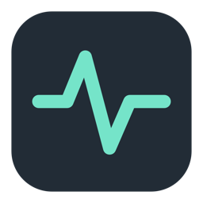
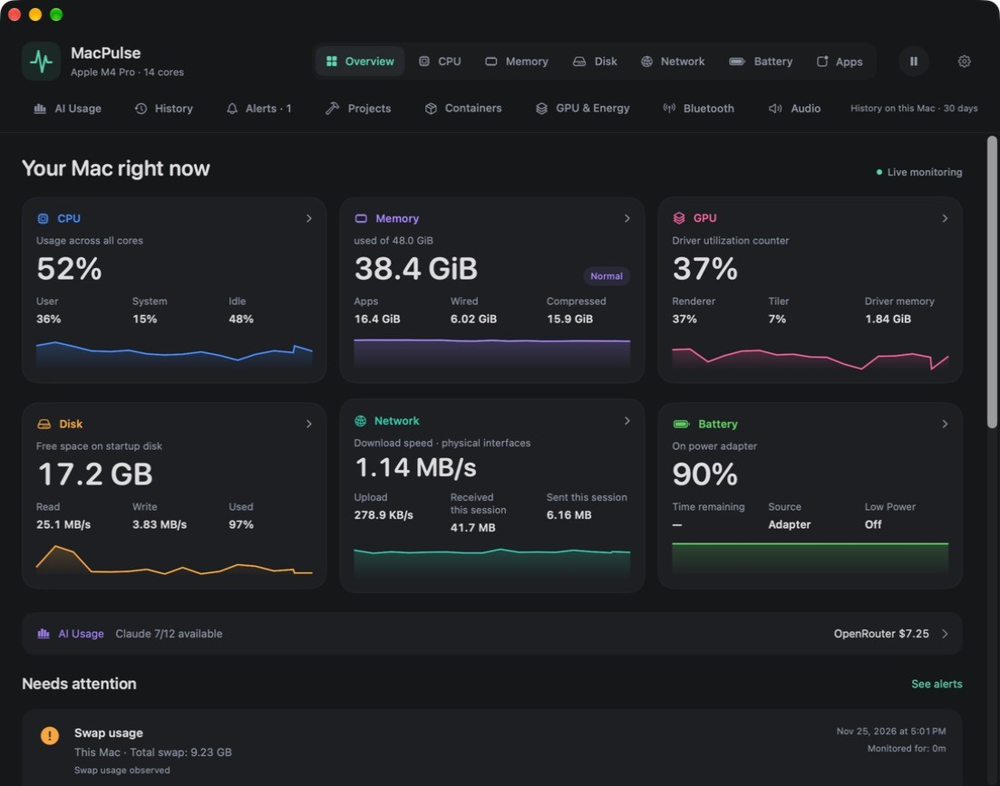
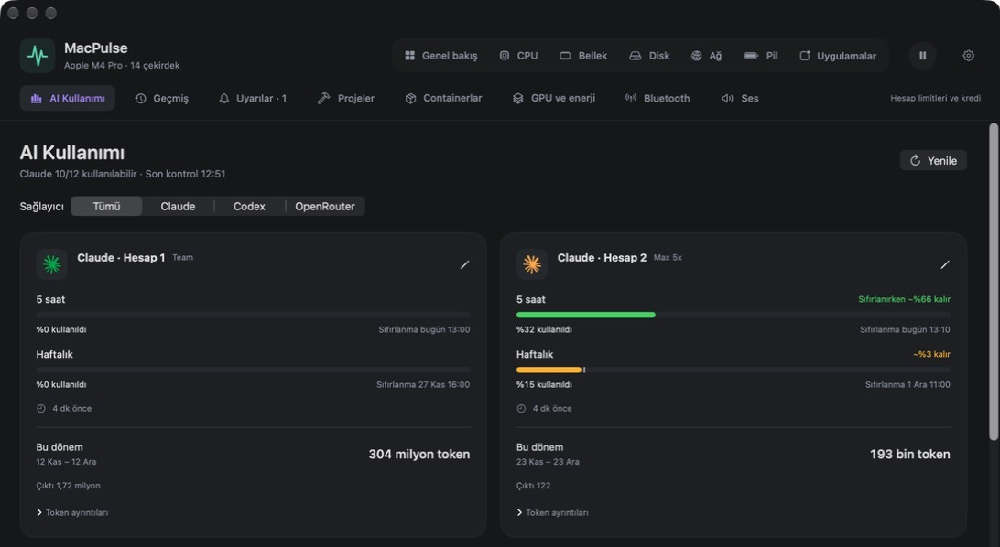
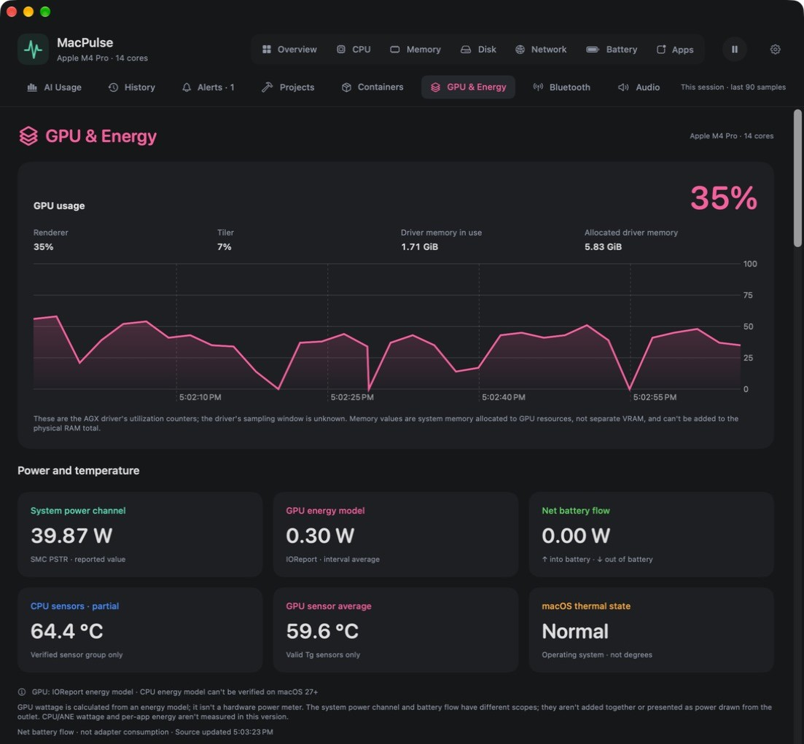
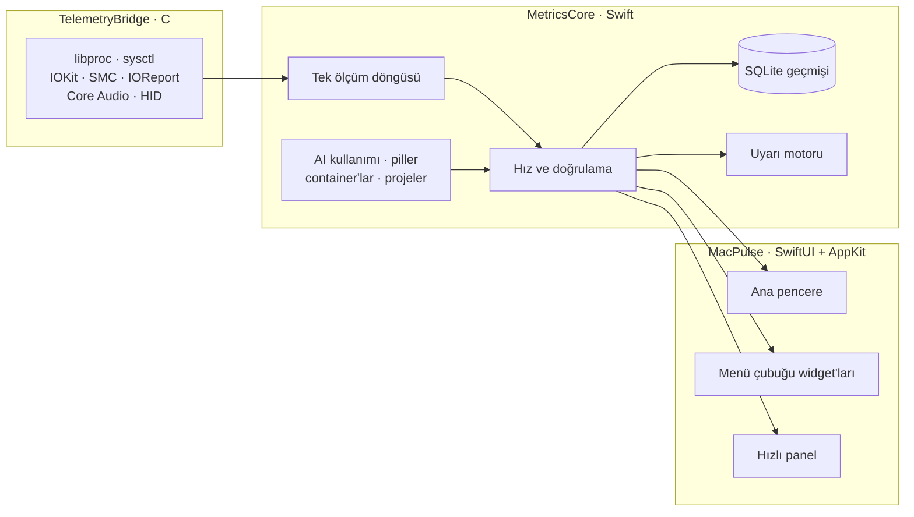

<div align="center">



# MacPulse

**Mac'inin nabzı, yapay zekâ kodlama limitlerin ve sahip olduğun her cihazın pili, tek bir yerel menü çubuğu uygulamasında.**

<p>
  
  
  
  
  
  
</p>

[English](README.md) · **Türkçe**



</div>

---

## Neden MacPulse?

Gün boyu yapay zekâ ajanlarıyla kod yazıyorsan sürekli üç şeye bakarsın: *Mac zorlanıyor mu, Claude / Codex limitimden ne kaldı, AirPods'un şarjı bitmek üzere mi?* Bu cevaplar normalde Etkinlik Monitörü'ne, bir terminal komutuna, bir tarayıcı sekmesine ve Bluetooth menüsüne dağılmış durumdadır.

MacPulse hepsini, arka planda çalışan tek bir ölçüm döngüsüyle tek yere toplar. Menü çubuğunu da önemsediğin sayılardan kendin kurarsın.

- **Yapay zekâ limitleri bir bakışta.** **Birden çok Claude Code hesabının** 5 saatlik ve haftalık limitlerini, Codex limitlerini ve OpenRouter bakiyesini gösterir. Sıfırlanma saatlerini ve limitin pencere bitmeden dolup dolmayacağını söyleyen tempo tahminini de verir.
- **Gerçek bir sistem monitörü.** CPU, bellek baskısı, disk, ağ, GPU, güç, sıcaklık ve fanları kapsar. Süreç adları yığını yerine *uygulamaya* göre gruplar.
- **Bütün piller tek listede.** Mac, AirPods (sol/sağ/kutu), Bluetooth aksesuarları, Logitech fare ve klavyeler, eşleşmiş iPhone, iPad, Apple Watch ve Apple Pencil. Hepsinin 7 günlük geçmişi tutulur.
- **Geliştiriciyi tanır.** Dinleyen portları hangi proje klasörüne ait olduklarıyla eşler. Yerel Docker, OrbStack ve Podman container'larını onlara dokunmadan okur.
- **Yerel, salt okunur, dürüst.** Hesap, sunucu ya da analitik yoktur. Bilinmeyen değer sahte bir `0` olarak değil, `—` olarak görünür.

## Özellikler

### 🤖 Yapay zekâ kullanımı



| | |
|---|---|
| **Çoklu Claude Code hesabı** | Varsayılan `~/.claude` girişin ve ek yapılandırma klasörlerin (`~/.claude-hesap2`, `~/.claude-hesap3`, …) ayrı kartlarda görünür: plan, 5 saatlik ve haftalık kullanım, sıfırlanma saatleri. |
| **Tempo tahmini** | Her limitin pencere sonunda nereye varacağını doğrusal olarak hesaplar. "Yolunda", "sınıra yakın" ya da "sıfırlanmadan dolacak" durumlarını yeşil, turuncu ve kırmızıyla gösterir. |
| **Token toplamları** | Fatura dönemindeki girdi, çıktı ve iki önbellek sayısı, Claude Code transcript'lerinden **yerelde** hesaplanır ve mesaj kimliğiyle tekilleştirilir. Mesaj içeriği saklanmaz, gönderilmez. |
| **Codex ve OpenRouter** | Codex limitleri mevcut `~/.codex` oturumundan, OpenRouter bakiyesi Anahtar Zinciri'nden okunur. |
| **API'ye nazik** | Ağa yalnız kayıtlı okuma 5 dakikadan eskiyse ya da Yenile'ye (`⌘R`) basarsan çıkar. Hata sonrası bekleme süresi hesaplar arasında paylaşılır. Kimlik bilgileri salt okunurdur; yenilenmez, yazılmaz, loglanmaz. |

### 🖥️ Sistem monitörü

- **CPU.** Tüm çekirdeklerde kullanıcı, sistem ve boşta oranı; uygulama başına CPU'da bir çekirdek %100'dür.
- **Bellek.** Kullanılan ve kullanılabilir bellek, uygulama / sabit / sıkıştırılmış dökümü, swap ve işletim sisteminin bellek baskısı.
- **Disk.** Başlangıç diskindeki boş alan ve fiziksel sürücülerin canlı okuma/yazma hızı.
- **Ağ.** İndirme ve yükleme yalnız *fiziksel* arayüzlerden ölçülür; VPN, bridge ve loopback trafiği iki kez sayılmaz.
- **GPU ve enerji.** Apple GPU (AGX) renderer ve tiler kullanımı, GPU belleği, watt cinsinden GPU enerji modeli, sistem güç kanalı, pil net akışı, doğrulanmış sıcaklık sensörleri ve gerçek fan devri.
- **Süreç değil, uygulama.** Yardımcı süreçler ve XPC servisleri ait oldukları uygulamada toplanır. Arama yapabilir; CPU, bellek ya da ada göre sıralayabilir; PID, ebeveyn, RSS ve başlangıç zamanı ayrıntısına inebilirsin.
- **Bluetooth ve ses.** Cihaz envanteri ve bağlantı durumu; varsayılan cihazlar, kanal sayısı, örnekleme hızı ve ses seviyesiyle Core Audio cihazları.



### 🔋 Cihaz pilleri

- Güç kaynağı, kalan süre ve düşük güç moduyla Mac pili.
- AirPods ve diğer Bluetooth aksesuarları; **sol, sağ ve kutu** ayrı gösterilir.
- **HID++** üzerinden Logitech cihazları. Giriş İzleme izni yalnız düğmeye bastığında istenir.
- Daha önce güvenilmiş **iPhone, iPad, Apple Watch ve Apple Pencil**.
- Her cihaz için 6 saat, 24 saat ve 7 günlük geçmiş; ad değiştirme, favori, gizleme, sıralama ve düşük pil uyarıları.
- Her cihaz kendi menü çubuğu widget'ı olabilir.

### 🧑‍💻 Geliştiriciler için

- **Projeler.** Dinleyen TCP portları en yakın proje köküyle (`.git`, SwiftPM, Node, Python, Rust, Go, Ruby, Java, PHP, CMake) eşlenir. Canlı süreç ağacı ve "boşta sunucu" ipucu da gösterilir.
- **Container'lar.** Docker Desktop, OrbStack ve Podman yerel soketlerinden yalnız `GET` istekleriyle okunur: durum, port eşlemeleri, Compose projesi, CPU, bellek ve ağ. MacPulse hiçbir şeyi başlatmaz, durdurmaz ya da sonlandırmaz.

### 📈 Geçmiş ve uyarılar

- SQLite'ta 30 günlük yerel geçmiş tutulur. 1 sa / 24 sa / 7 g / 30 g görünümleri örnek sayısına göre değil, ölçülen süreye göre ağırlıklandırılır.
- Yerleşik uyarılar:
  - uzun süren yüksek CPU (sistem ≥ %85 ya da tek uygulama ≥ %80, 2 dakika boyunca);
  - yoğun disk ya da ağ etkinliği;
  - bellek büyümesi (10 dakikada ≥ 512 MiB);
  - swap kullanımı.
- macOS bildirimleri **varsayılan olarak kapalıdır**; izin yalnız sen açtığında istenir.

### 🧩 Menü çubuğu senin elinde

- Widget düzenleyicisinde her metrik, her AI hesabı ve her cihaz ayrı bir widget'tır. Ekleyip çıkarabilir, sıralayabilir; çubuk, yüzde ya da ikisini, kullanılan ya da kalanı seçebilirsin.
- **"AI · En yüksek 4 (5 saat)"** modu, 5 saatlik limitine en çok yaklaşan dört hesabı her zaman gösterir.
- Hızlı panelde (`⌘⇧M`) AI, Mac ve Piller görünümleri vardır. Canlı önizleme, gerçek menü çubuğuyla aynı çizimi kullanır.

## Kurulum ve derleme

MacPulse kaynaktan SwiftPM ile derlenir. İndirilen harici paket yoktur.

**Gereksinimler:** macOS 14 veya üstü, Swift 6 içeren Xcode ya da Command Line Tools.

```sh
git clone https://github.com/ozanbilgili/macpulse.git
cd macpulse

swift test --build-system native                 # testleri çalıştır
SIGNING_MODE=adhoc Scripts/package_app.sh release   # ./MacPulse.app oluşturur
Scripts/launch.sh                                   # uygulamayı açar
```

- Uygulama **kendi Mac'in için ad-hoc imzalanır**. Henüz notarize edilmiş bir indirme yok.
- Yeniden paketlemeden önce çalışan kopyadan `⌘Q` ile çık. Script çalışan uygulamayı değiştirmez; yeni paketi ancak kontrollerden geçince yerine koyar.
- **İsteğe bağlı:** Homebrew'un `libimobiledevice` paketi kuruluysa paketleme Apple Watch pil yardımcısını da derler. Kurulu değilse geri kalan her şey yine çalışır.

### Terminalden ölçüm (probe)

`MacPulseProbe` aynı metrik çekirdeğini terminalde çalıştırır ve JSON basar. Mac'inin neleri açığa verdiğini görmek için kullanışlıdır.

```sh
swift run --build-system native MacPulseProbe --samples 10
swift run --build-system native MacPulseProbe --verify-hardware --verify-history
```

## Klavye kısayolları

| Kısayol | İşlev | Kısayol | İşlev |
|---|---|---|---|
| `⌘1` … `⌘7` | Genel bakış, CPU, Bellek, Disk, Ağ, Pil, Uygulamalar | `⌘⇧U` | AI Kullanımı |
| `⌘8` | Geçmiş | `⌘⇧W` | Menü çubuğu widget düzenleyicisi |
| `⌘9` | Uyarılar | `⌘⇧M` | Hızlı panel |
| `⌘0` / `⌘⇧0` | Projeler / Container'lar | `⌘⇧P` | İzlemeyi duraklat / sürdür |
| `⌘⇧G` | GPU ve enerji | `⌘R` | AI kullanımını yenile |
| `⌘⇧B` / `⌘⇧S` | Bluetooth / Ses | `⌘,` | Tercihler |

## Nasıl çalışır?



- **Tek bir ölçüm döngüsü** ana iş parçacığının dışında çalışır. Pencere görünürken 2 saniyede bir (2, 5 ya da 10 sn seçilebilir), arka planda 10 saniyede bir ölçer. Pencereyi kapatmak ölçümü durdurmaz.
- Sistem API erişimi `TelemetryBridge`'de, hesaplamalar `MetricsCore`'da, görünümler `MacPulse`'tadır. `MetricsCore` 200'den fazla testle korunur.
- Süreç kimliği **PID ile başlangıç zamanının birleşimidir**; yeniden kullanılan bir PID eski süreçle karışmaz.
- Uyku, duraklatma ya da uzun bir boşluktan sonraki ilk örnek yeni başlangıç noktası sayılır. Aradaki trafik ani bir hız sıçraması gibi gösterilmez.

## Gizlilik

- **Her şey Mac'inde kalır.** Hesap, analitik, reklam, çökme raporu ya da uygulama sunucusu yoktur.
- Tek ağ çağrısı AI kullanım sorgularıdır. Bunlar zaten sahip olduğun kimlik bilgisiyle her sağlayıcının kendi API'sine gider: kullanım limitleri, OpenRouter bakiyesi ve Claude için hesap profili.
- Sistem izleme içerik değil, yalnız metadata okur. Dosya içerikleri, süreç argümanları ve ortam değişkenleri okunmaz; proje tespiti yalnız işaret dosyalarının *var olup olmadığına* bakar.
- Tek istisna AI kullanımıdır. Token saymak için Claude Code transcript'lerini **yerelde** okur ve yalnız sayıları saklar. Mesaj içeriği saklanmaz, gönderilmez.
- Geçmiş dosyalarını yalnız senin kullanıcın okuyabilir. Süreç listeleri, proje yolları, container verileri ve Bluetooth adresleri geçmiş veritabanına yazılmaz.
- Cihaz pillerinin kendine ait özel bir deposu vardır (klasör `0700`, dosyalar `0600`). Bir Bluetooth cihazının oradaki kimliği adresini içerebilir.

Ayrıntılar [docs/PRIVACY.md](docs/PRIVACY.md) dosyasında.

## Durum ve sınırlar

MacPulse her gün kullandığım kişisel bir proje. Denemeden önce şunları oku:

- **Arayüz İngilizce ve Türkçe.** MacPulse macOS dil tercihini izler (Türkçe tercih edildiğinde Türkçe, diğer dillerde İngilizce); sayı, yüzde ve tarih biçimleri bölge ayarına uyar. Bazı belgeler yalnız Türkçe. Yeni çevirilere açığız: metinler `Sources/MacPulse/Resources/Localizable.xcstrings` dosyasındadır, `python3 Scripts/localization.py check` denetler.
- **Tek bir makinede test edildi** (Apple M4 Pro, macOS 27). Intel Mac'ler ve eski macOS sürümleri denenmedi.
- **SMC ve IOReport belgelenmemiş Apple arayüzleridir.** Başka donanımda bazı sensörler `—` gösterebilir. Fan kontrolü ya da yönetici yardımcısı yoktur.
- **AI kullanımı, resmî CLI'ların kullandığı belgelenmemiş sağlayıcı uç noktalarına dayanır.** Bu uç noktalar haber vermeden değişebilir; o durumda uygulama güncellenene kadar kartlar `—` gösterir.
- **Notarize edilmiş bir sürüm yok.** Yukarıdaki gibi kendin derleyip ad-hoc imzalarsın.

## Dokümanlar

| Doküman | İçerik |
|---|---|
| [docs/TECHNICAL.tr.md](docs/TECHNICAL.tr.md) | Her sayının anlamı, ölçüm kapsamı ve uç durumlar |
| [docs/AI-USAGE.md](docs/AI-USAGE.md) | AI kullanımı veri kaynakları, önbellek ve tempo modeli |
| [docs/DEVICE-BATTERIES.md](docs/DEVICE-BATTERIES.md) | Cihaz pili kaynakları ve bağlantı sınırları |
| [docs/INSTALL.md](docs/INSTALL.md) · [docs/RELEASE.md](docs/RELEASE.md) | Çalıştırma, güncelleme ve paketleme |
| [CHANGELOG.md](CHANGELOG.md) | Sürüm notları |

## Teşekkürler

- SMC ve IOReport protokol düzeni [vladkens/macmon](https://github.com/vladkens/macmon) projesinden uyarlandı (MIT).
- Paketleme scripti [Dimillian/Skills](https://github.com/Dimillian/Skills) temel alınarak yazıldı (MIT).
- Sağlayıcı simge yolları [OpenUsage](https://github.com/robinebers/openusage) (MIT) ve [lobe-icons](https://github.com/lobehub/lobe-icons) (MIT) projelerinden alındı.

Tüm bildirimler [docs/THIRD-PARTY.md](docs/THIRD-PARTY.md) dosyasında.

MacPulse bağımsız bir projedir. Apple, Anthropic, OpenAI ya da OpenRouter ile bağlantılı değildir ve onlar tarafından desteklenmez. Tüm markalar sahiplerine aittir.

## Lisans

[MIT](LICENSE) © Ozan Bilgili
